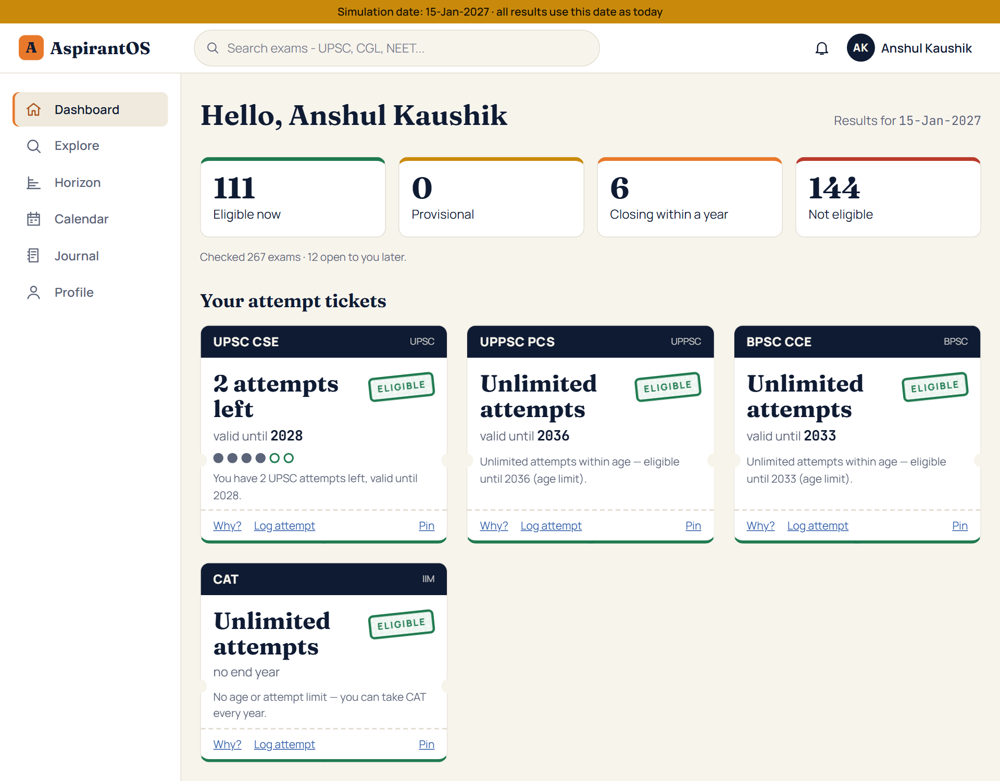
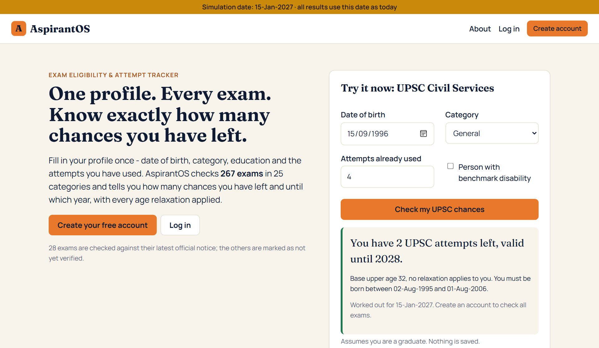
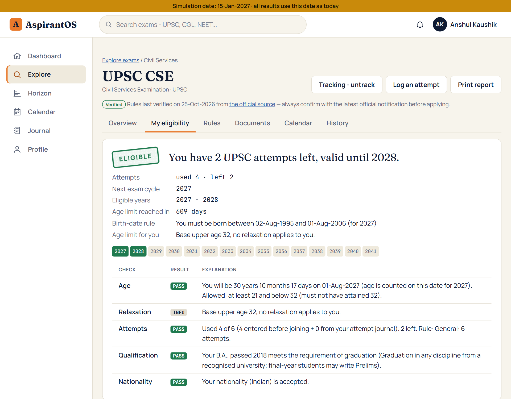
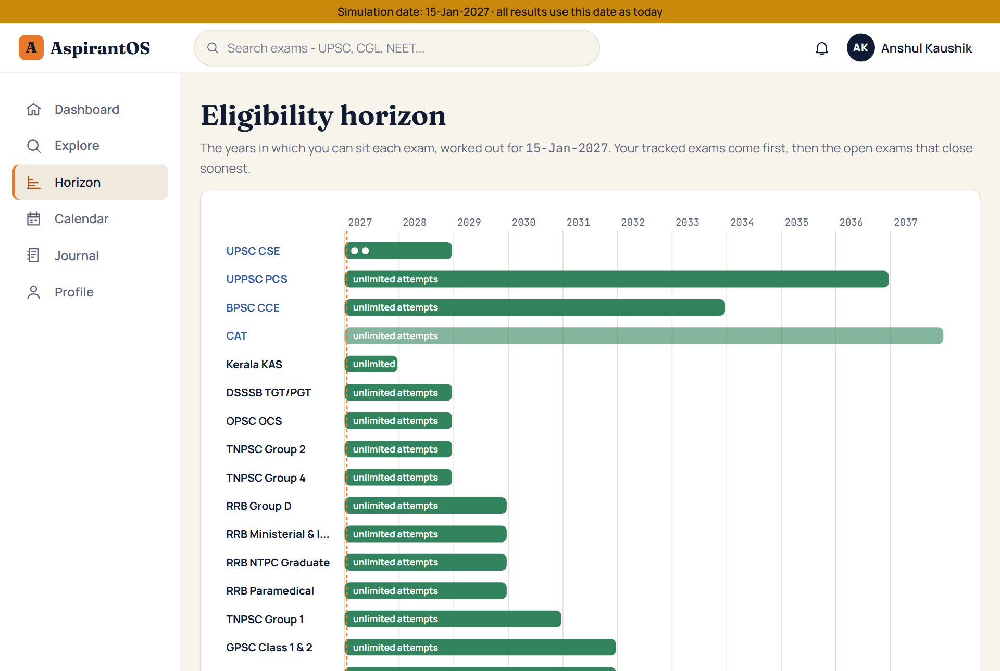
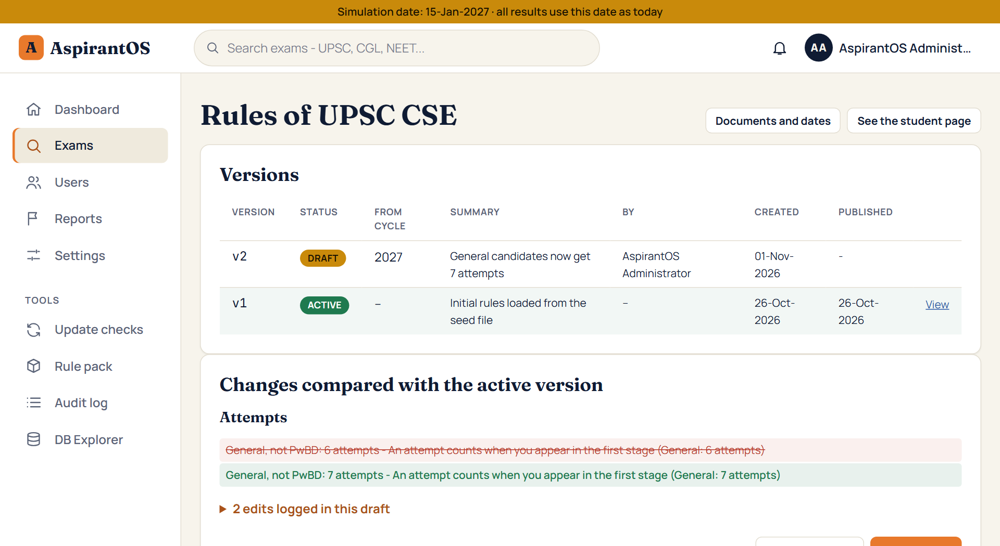
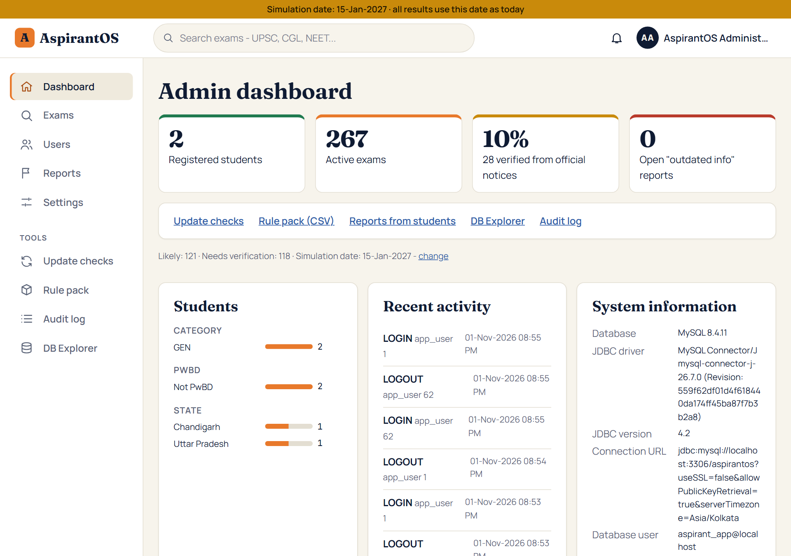
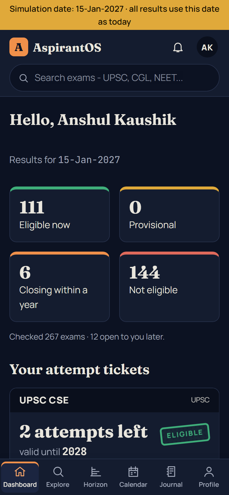

# AspirantOS — Exam Eligibility & Attempt Tracker

AspirantOS answers the question every Indian exam aspirant keeps asking: **"Am I still eligible, and how many attempts do I have left?"** A student enters their profile once (date of birth, category, education, attempts already used). The app then checks **267 exams** (UPSC, SSC, banking, railways, defence, state PSCs, teaching, entrance tests and more) against versioned rules and shows the result as an "attempt ticket", for example:

> **You have 2 UPSC attempts left, valid until 2028.**

It is an MCA mini project for *Advanced Internet Programming (26CAH-614)* at Chandigarh University, by **Anshul Kaushik** (UID 26MCI10329, MCA - AI & ML, Section 26MAM5-B), submitted to Mr. Shivam Ojha (Assistant Professor). It is built with **JSP + JDBC + MySQL** in the same style as the lab experiments (StudentCRUD, Experiments 4 and 5).



---

## Contents

1. [Features](#features)
2. [Technology](#technology)
3. [How it is built](#how-it-is-built)
4. [How to run](#how-to-run)
5. [Accounts](#accounts)
6. [Project layout](#project-layout)
7. [Tests](#tests)
8. [Documentation](#documentation)
9. [Screenshots](#screenshots)

---

## Features

### For students

- **Register and fill the profile** in a 4-step wizard: personal details, category and special status (PwBD, ex-serviceman, government employee), education with subjects and work experience, and attempts already used.
- **Dashboard ("Eligibility Radar")** with:
  - counters: eligible now, provisional, closing within a year, not eligible;
  - **attempt tickets** for the tracked exams: a rubber stamp, attempts left shown as dots, and the last eligible year;
  - alerts (an age limit coming close, a certificate running out) and the upcoming exam dates.
- **Exam Explorer** with filters, and an **exam page** with these tabs: overview, *my eligibility* (every check explained line by line), rules, documents (photo and signature sizes), calendar and rule history.
- **Eligibility Horizon:** an SVG chart of the years in which each exam is still open to you, plus an age clock.
- **Exam calendar** with `.ics` downloads for Google Calendar or Outlook.
- **Attempt journal:** log each attempt, and the attempt count updates by itself (database trigger).
- **Notifications** when the rules of a tracked exam change.
- **Report outdated information** to the admin.
- **Light and dark theme**, a phone layout and print styles for the eligibility report and the profile sheet.

### For the administrator

- **Admin dashboard** with counters, student statistics, recent activity and system information (`DatabaseMetaData`).
- **Exams:** add, edit and deactivate. Rules are kept in **versions**: draft → publish → archived.
  - The admin sees a diff of the draft against the active version before publishing.
  - Publishing notifies every student who tracks the exam, and their results are recalculated.
- **Update checker:** downloads an exam's official page, compares it with the last check and highlights lines that mention keywords such as "age limit" or "attempts".
- **Rule pack:** import and export all rules as CSV in one transaction.
- **Documents and dates editors**, the **reports inbox**, the **audit log** and **users** (block or unblock).
- **App settings**, including a **simulation date** (for example 15-Jan-2027) so the demo always shows the same results.
- **DB Explorer:** a scrollable and updatable `ResultSet` with `ResultSetMetaData`.

---

## Technology

| Part | Used |
|---|---|
| Language | Java 21 (Eclipse Adoptium JDK 21) |
| Web | JSP only, on **Apache Tomcat 11** (Jakarta EE 11, `jakarta.*` packages). There are no Servlet classes: every page and every form action is a JSP, which Tomcat turns into a servlet. |
| Database | **MySQL 8.4 LTS**: 26 tables, 6 views, 3 functions, 5 stored procedures (plus 16 helper procedures used only by the seed scripts) and 19 triggers |
| Database access | **JDBC only**, through MySQL Connector/J (a Type 4 driver). No Hibernate, no ODBC. |
| Front end | HTML, CSS (design tokens, light and dark theme, print stylesheet) and plain JavaScript. No frameworks. Fonts are bundled. |
| IDE | Eclipse IDE for Enterprise Java (Dynamic Web Project, no Maven) |

**Jars** (in `src/main/webapp/WEB-INF/lib`):

| Jar | Version | Why |
|---|---|---|
| `mysql-connector-j-26.7.0.jar` | 26.7.0 | The MySQL JDBC driver (Type 4) |

That is the only jar. The Servlet and JSP API comes from Tomcat itself. JSTL is not used: loops are scriptlets, as in Experiment 4.

> **javax or jakarta?** The theory notes use `javax.servlet` (Tomcat 9). Tomcat 10 and later need `jakarta.servlet`, so this project uses `jakarta.*`, as the lab worksheets do.

---

## How it is built

```
 Tier 1  Browser            HTML + CSS + JS produced by the JSPs
            |  GET (pages, search)   POST (every change)
            v
 Tier 2  Tomcat 11          view JSP  (shows a page)
                            action JSP (reads the form -> validates -> calls the DAO
                                        -> flash message in the session -> sendRedirect)
                            JavaBeans (model), DAO classes (JDBC), eligibility engine
            |  JDBC (Connector/J, Type 4)
            v
 Tier 3  MySQL 8.4          tables, views, stored procedures, functions, triggers
```

- **JSP Model 1.** A *view* page and an *action* page per feature (Post/Redirect/Get), as in `employee-form.jsp` of Experiment 5. Shared parts are static includes (`header.jspf`, `footer.jspf`, `auth-check.jspf` ...).
- **One `DBConnection` class**, in the exact shape of Experiment 4, is used by every DAO. All user input goes through `PreparedStatement`. Stored procedures are called with `CallableStatement`. The rule-pack import is one transaction.
- **The eligibility engine** (`com.aspirantos.engine`) is plain Java, with a self-test of 61 cases. For each exam it works out:
  - age on the cut-off date, with category, PwBD and ex-serviceman relaxations;
  - attempts used and left;
  - the qualification check (including final-year students);
  - the years in which the exam stays open.
- **Results are cached** in `eligibility_snapshot`. The cache is cleared by triggers when the profile, the education or the rules change.

The **About** page (`/about`) shows the same architecture as a diagram, the request flow of a profile save and the ER diagram (`docs/diagrams/er-diagram.svg`).

---

## How to run

The full step-by-step guide, with screenshots of what to click, is in **[docs/SETUP_GUIDE.md](docs/SETUP_GUIDE.md)** (in Hinglish). In short:

1. **Get the code and install the tools:**
   ```
   git clone https://github.com/supremedrip1301-ai/aspirantos.git
   ```
   Then install JDK 21, MySQL 8.4 (service `MySQL84`), Tomcat 11 (zip) and Eclipse IDE for Enterprise Java.
2. **Create the database.** Run the scripts **as root**, because functions and triggers need it:
   ```
   cd D:\AIP\AspirantOS\sql
   mysql -u root -p --default-character-set=utf8mb4 < RUN_ALL.sql
   ```
   `RUN_ALL.sql` runs every numbered script in order. It can be run again safely. The web application connects as `aspirant_app` / `Aspirant@123` (created by `00_create_database_and_user.sql`).
3. **Import into Eclipse:**
   - File → Import → General → Existing Projects into Workspace → `D:\AIP\AspirantOS`.
   - Do **not** tick "Copy projects into workspace".
4. **Run.** Right-click the project → **Run As → Run on Server** → Tomcat v11.0. Then open **http://localhost:8080/AspirantOS/**.

Without Eclipse (compile check and WAR for a standalone Tomcat):

```
tools\build.cmd
```

This builds `build\AspirantOS.war` (`tools/build.sh` does the same in Git Bash).

---

## Accounts

- **Administrator:** `admin@aspirantos.in` / `Admin@123`. This is the only account the database creates, and it has every admin power. **Change this password** after the first login: click the name in the top right corner → *My settings* → *Change password*.
- **Students:** there are no ready-made student accounts. Students **register themselves** on the *Create account* page, fill the profile wizard and see their results on the dashboard.
- For the demo, the sample details to type are in [docs/DEMO_SCRIPT.md](docs/DEMO_SCRIPT.md). After a rehearsal:
  - delete the rehearsal student from its own Settings page;
  - run `sql/reset_after_demo.sql` as root. It puts the UPSC rules back to version 1 and switches the simulation date off.

---

## Project layout

```
AspirantOS/
|-- src/main/java/com/aspirantos/
|   |-- util/        DBConnection (Experiment 4 shape), HtmlUtil, DateUtil, ValidationUtil,
|   |                PasswordUtil (PBKDF2), RuleText, RuleDiff, IcsUtil, CategoryIcons
|   |-- model/       JavaBeans (User, Profile, ProfileBean for the wizard, Exam, rules ...)
|   |-- dao/         JDBC DAOs (UserDAO, ProfileDAO, ExamDAO, RuleVersionDAO, RulePackDAO,
|   |                DbExplorerDAO, DashboardDAO ...)
|   |-- engine/      eligibility engine + EngineSelfTest (61 cases)
|   `-- service/     EligibilityService (cache), UpdateChecker, UpdateCheckJob,
|                    RuleValidator, RulePackParser
|-- src/main/webapp/
|   |-- index.jsp, home.jsp, login.jsp, register.jsp, error.jsp ...   public pages
|   |-- aspirant/    student pages (view JSP + action JSP)
|   |-- admin/       admin pages (view JSP + action JSP)
|   |-- assets/      css (tokens, app, print), js, fonts (OFL), img
|   `-- WEB-INF/     web.xml, jspf/ (header, footer, flash, auth checks), about.jsp,
|                    includes/, lib/ (Connector/J)
|-- sql/             00-40 numbered scripts, RUN_ALL.sql, 98_integrity_checks.sql,
|                    99_reset_all.sql (danger: drops everything), reset_after_demo.sql,
|                    sample_rule_pack.csv
|-- tools/           build.cmd / build.sh, smoke tests (*.sh), er_diagram.py
`-- docs/            specification, progress, decisions, guides (see below)
```

---

## Tests

| Test | What it covers | Result (26-Oct-2026) |
|---|---|---|
| `EngineSelfTest` (`java -cp build/cli/classes com.aspirantos.engine.EngineSelfTest`) | Age, relaxation, attempts, qualification, horizon, including the exact demo sentence | 61 / 61 |
| `tools/smoke-auth.sh` | Register, login, logout, remember-me, profile wizard, settings | 35 / 35 |
| `tools/smoke-exams.sh` | Explorer, exam page, tracking, journal, dashboard, notifications, reports | 30 / 30 |
| `tools/smoke-features.sh` | Landing page, instant check (JSON), About, error page, horizon, calendar, `.ics` | 21 / 21 |
| `tools/smoke-design.sh` | Fonts, layout, sidebar, toasts, print, theme | 18 / 18 |
| `tools/smoke-admin.sh` * | Admin dashboard, users, settings, audit, exam CRUD, rule versions | 35 / 35 |
| `tools/smoke-admin2.sh` * | Update checker, rule pack, editors, reports inbox, DB Explorer | 35 / 35 |
| `tools/smoke-demo.sh` * | The whole demo story of DEMO_SCRIPT, followed by `reset_after_demo.sql` | 20 / 20 |
| `sql/98_integrity_checks.sql` | Every exam has an active version and its age, qualification and attempt rules | all problems 0 |

\* These scripts need the MySQL root password in the environment variable `MYSQL_PWD`, only to remove their test data at the end.

Every smoke test registers its own temporary student and deletes it again, so no student account stays in the database. Details are in [docs/TEST_REPORT.md](docs/TEST_REPORT.md).

---

## Documentation

| File | What is in it |
|---|---|
| [docs/SETUP_GUIDE.md](docs/SETUP_GUIDE.md) | Installation and first run, step by step (Hinglish) |
| [docs/DEMO_SCRIPT.md](docs/DEMO_SCRIPT.md) | 7-minute presentation script with sample students |
| [docs/VIVA_GUIDE.md](docs/VIVA_GUIDE.md) | Syllabus map (topic → file:line), 40 viva questions with answers, everything beyond the syllabus |
| [docs/DB_DESIGN.md](docs/DB_DESIGN.md) | Every table explained, plus the ER diagram |
| [docs/RULE_PACK_FORMAT.md](docs/RULE_PACK_FORMAT.md) | The CSV format of the rule pack |
| [docs/DATA_SOURCES.md](docs/DATA_SOURCES.md) | Official sources of the 28 verified flagship exams |
| [docs/TEST_REPORT.md](docs/TEST_REPORT.md) | What was tested and the results |

**About the exam data.** The rules of 28 flagship exams were checked against official notifications (marked *Verified*). The rest are marked *Likely* or *Needs verification*. Exam rules change every year, so always confirm with the latest official notification before applying.

---

## Screenshots

Taken from the running application (Tomcat 11, simulation date 15-Jan-2027, sample student profile).

**Landing page - instant UPSC check without an account**



**Exam page - "My eligibility" with every check explained**



**Eligibility Horizon - the years each exam stays open**



**Admin - rule versions and the diff before publishing**



**Admin dashboard**



**Dark theme on a phone**


